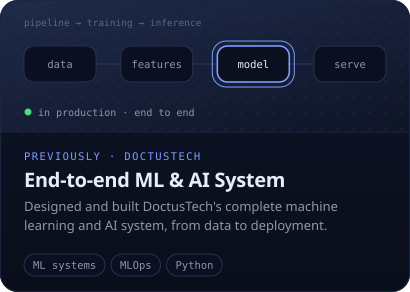

  

  
  

 

  

 

  

 

  
  

  
  

  
  

 

  Always happy to talk <b>ML systems</b>, <b>LLM agents</b>, <b>forecasting</b> or a gnarly <b>data problem</b>. 
  Say hi at <a href="mailto:sachinsingh31@outlook.com">sachinsingh31@outlook.com</a>.

  

